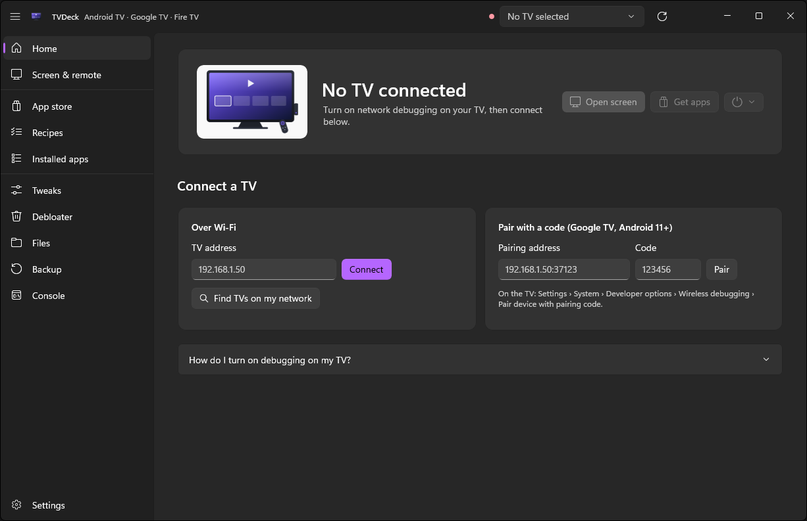
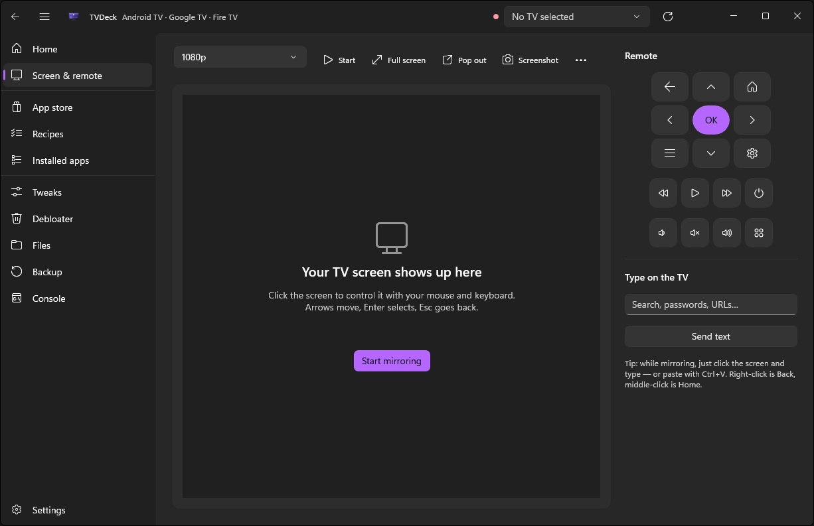
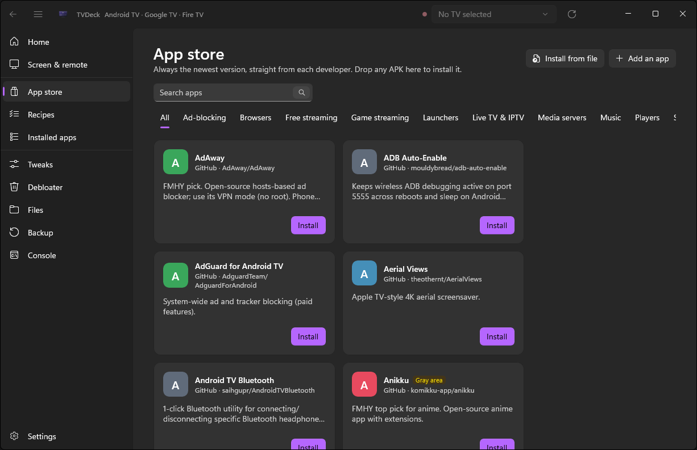
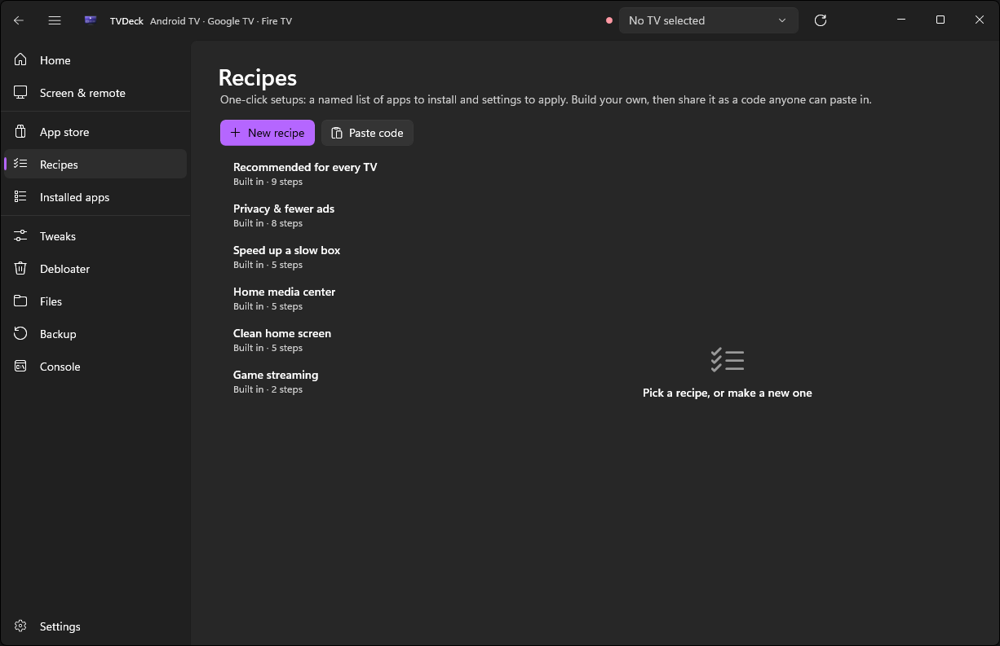
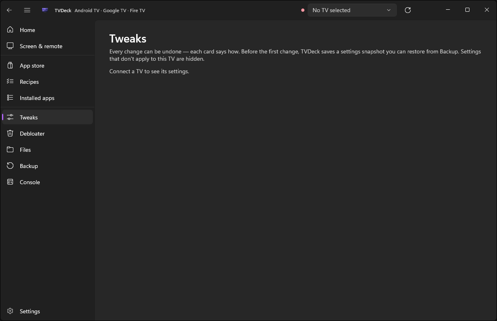
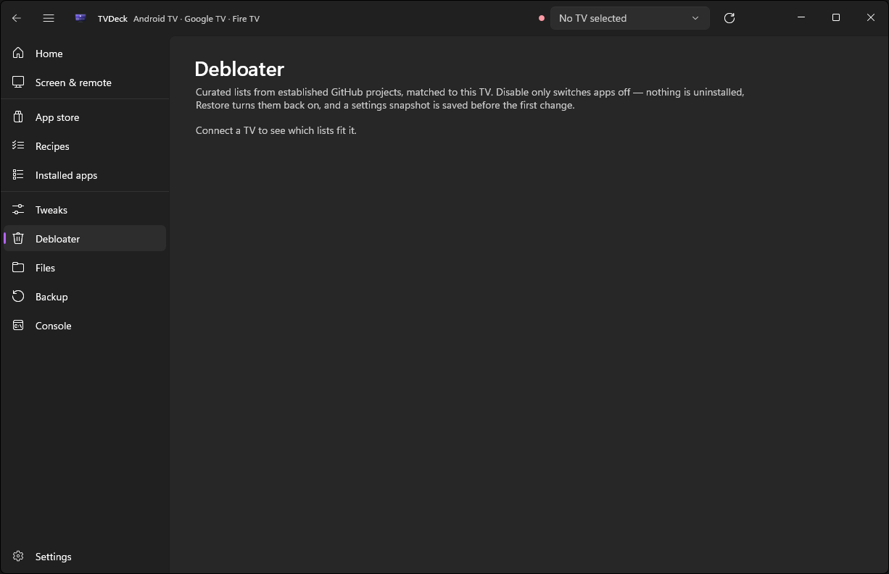
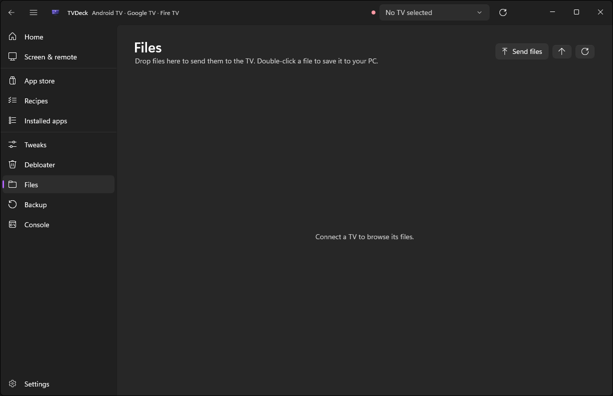
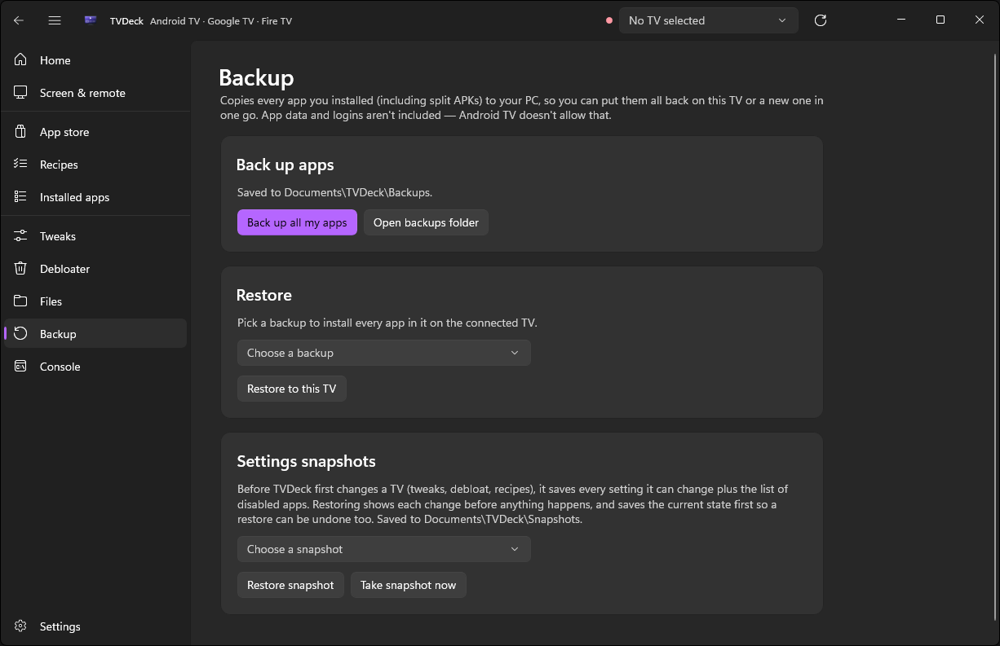
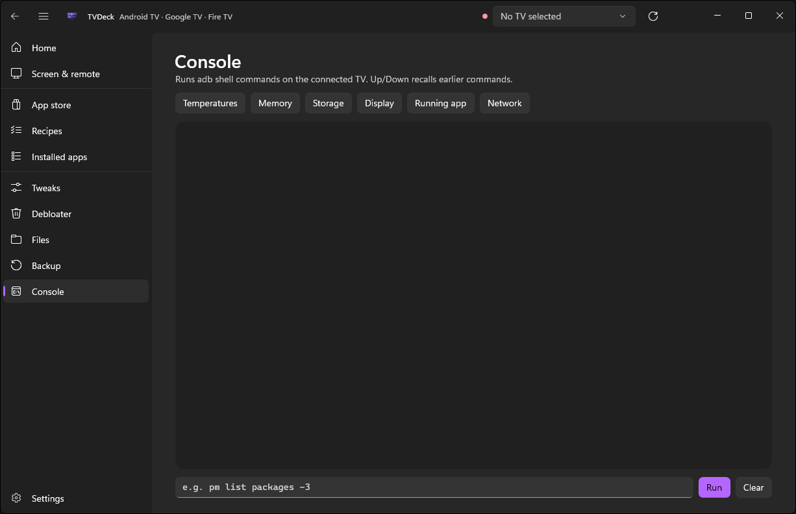
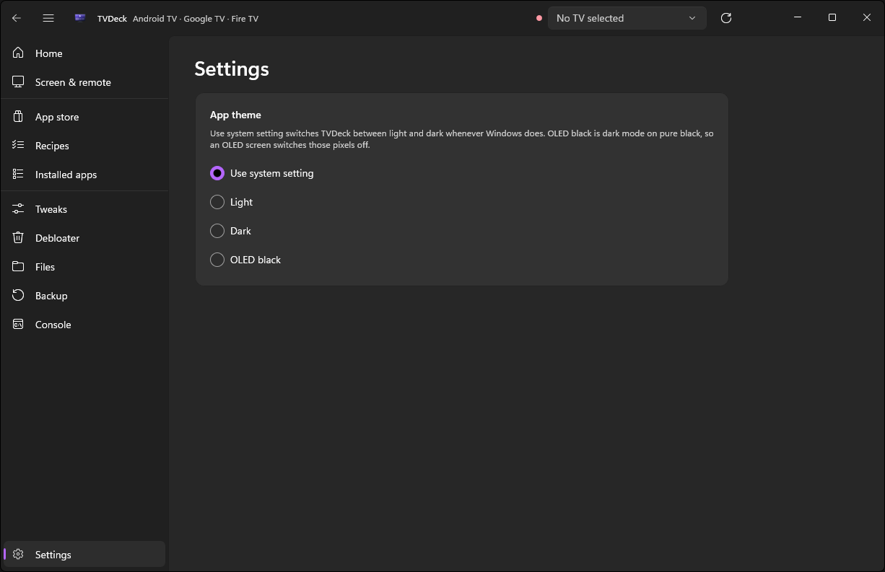

# TVDeck

TVDeck is a Windows desktop application for managing Android TV, Google TV, and Fire TV devices over ADB. It provides a graphical interface for tasks that would otherwise require command-line ADB: removing pre-installed bloatware, installing apps, mirroring screens, applying system tweaks, and managing files.

## Screenshots

| Home | Screen & remote | App store |
|------|----------------|-----------|
|  |  |  |

| Recipes | Tweaks | Debloater |
|---------|--------|-----------|
|  |  |  |

| Files | Backup | Console |
|-------|--------|---------|
|  |  |  |

| Settings |
|----------|
|  |

## Features

- **Debloating** — Remove pre-installed apps from a curated list of packages verified safe to remove. Every removal is preceded by an automatic snapshot.
- **Snapshots and backup** — Capture device settings and package states before making changes, with one-click restore.
- **App management** — Install APKs, view installed apps, and browse a curated app catalog.
- **Screen mirroring** — View and control the TV screen from the PC via scrcpy integration.
- **System tweaks** — Apply curated tweaks covering launchers, performance, and privacy settings.
- **File browser** — Browse and manage files on the connected device.
- **Recipes** — Save multi-step configurations as shareable codes.

## Safety

TVDeck is built around not breaking the connected device:

- Automatic snapshots before every destructive operation
- Strict input validation on all shell commands, tested against injection attacks
- Package names validated against a whitelist before reaching ADB
- 23 passing safety tests covering the command-construction boundaries

## Technology

- WinUI 3, .NET 10, C#
- ADB for device communication
- scrcpy for screen mirroring

## Background

TVDeck started from terminal-based Android debloating tools — the TUI approach to ADB device management. The goal was to rebuild that concept as a Windows desktop application with a graphical interface, safety guardrails, and an experience designed specifically for TV devices.

AI assistance was used during development for code review, architecture feedback, and documentation. Design decisions, safety rules, and implementation are the author's own.

## Status

In active development. Not yet released.
